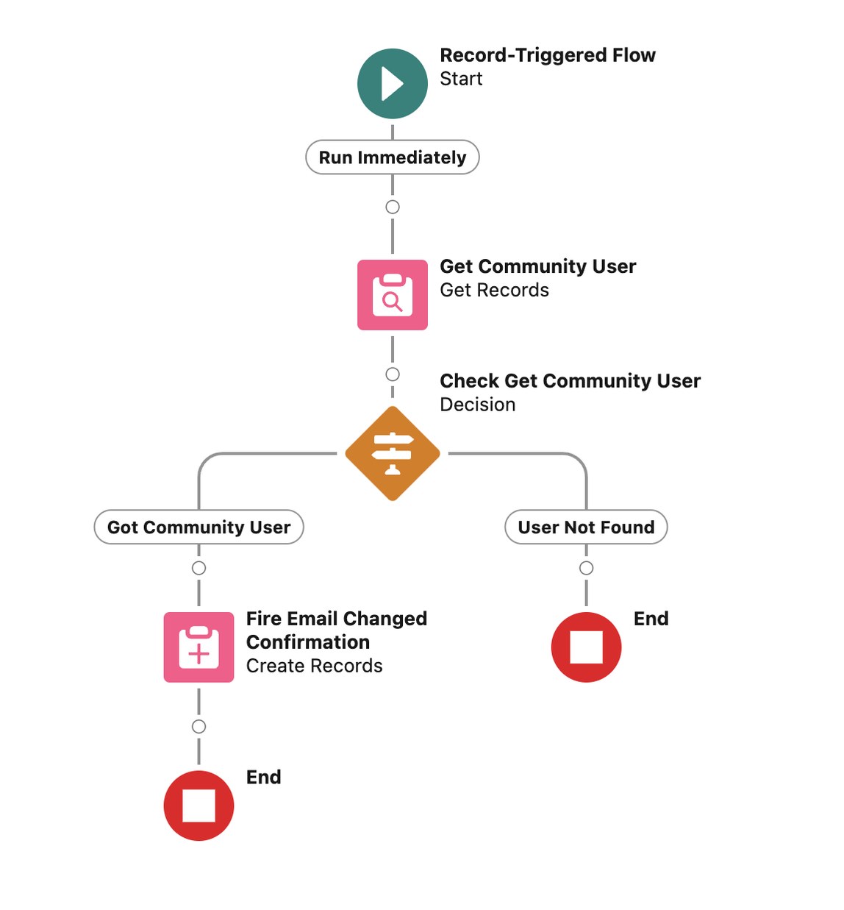
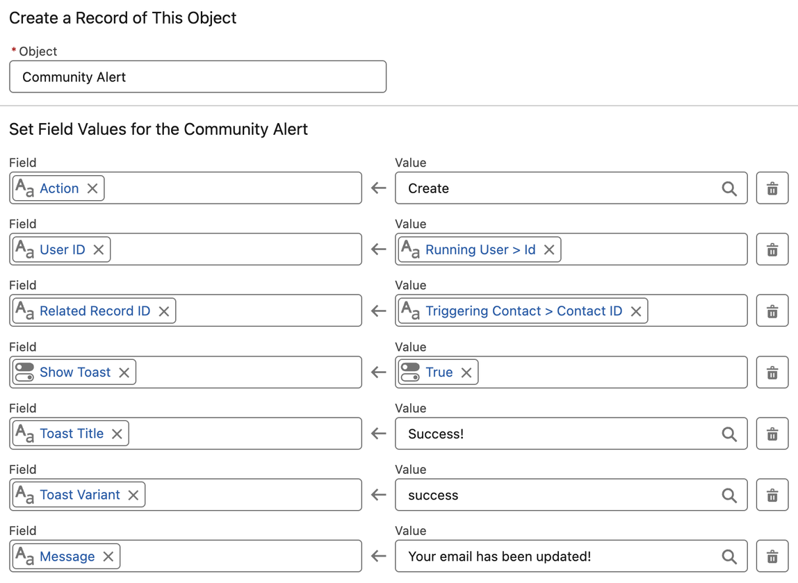
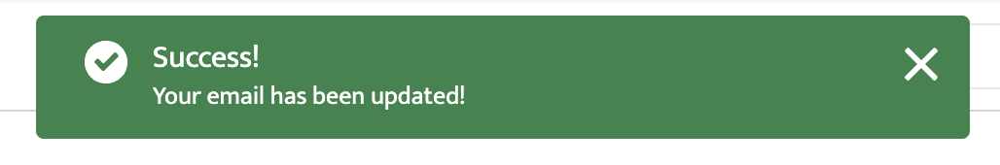
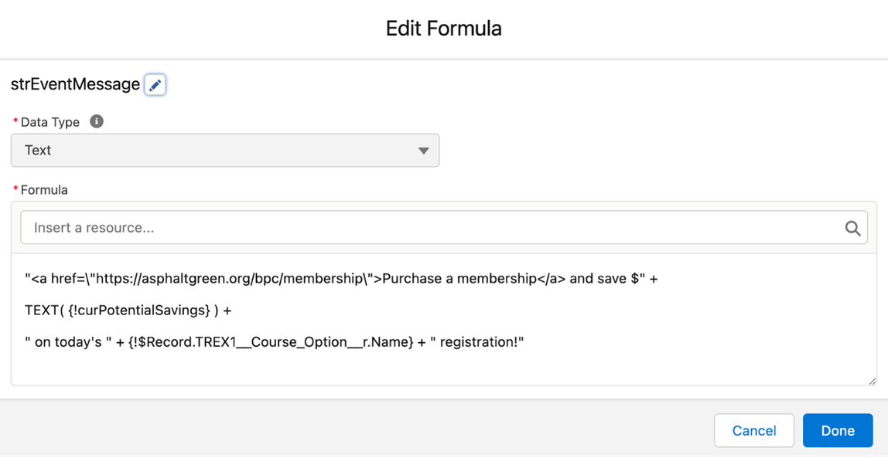
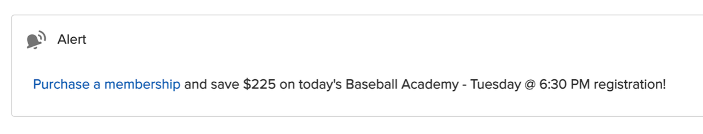
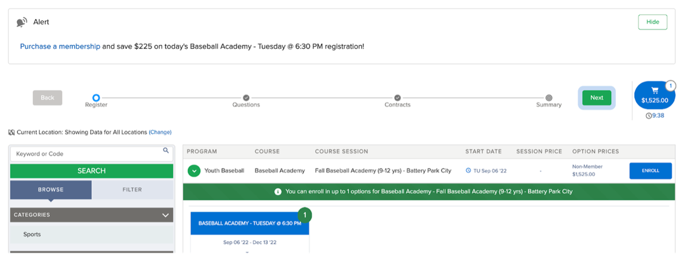

# Community Alerts

## Description

Communicate real-time information to community users based on database events.

## Installation

**Latest (ver 0.4) - Unlocked**

Production: <https://login.salesforce.com/packaging/installPackage.apexp?p0=04tPg0000001iyHIAQ>

Sandbox: <https://test.salesforce.com/packaging/installPackage.apexp?p0=04tPg0000001iyHIAQ>

[Archived Versions](index.md)

### Post-Installation Steps

- Add Community Alerts component to community pages
    - When adding the component to a page, enable Subtle Mode to show an alert button icon that can be clicked for more information, rather than the full alerts panel.
- Assign Community Alerts User permission set to external users that should see alerts

## Publishing Community Alerts

Alerts are shown to the user based on the details of Community Alert platform events that you publish in your automation.

> **Important**: Do not use Community Alerts to communicate any sensitive information, including PII such as names, emails, etc.. Though the typical user will only see alerts that are intended for them, it is possible for a bad actor to access all alerts, given the right skillset and intentions. **Compose your alerts as if anyone tuning into the right frequency could intercept them.**

### Publishing Alerts from Flow

This sample flow displays a confirmation message to the logged in user when the email address of their contact record has been successfully updated.



Here’s a look at the Create Records element above (Fire Email Changed Confirmation)



The resulting toast message when the logged in user’s contact’s email address is changed would look like this.



### Publishing Alerts from Apex

```
Id userId = UserInfo.getUserId();
String message = 'Here are some important details you should know';

List<alts__Community_Alert__e> alerts = new List<alts__Community_Alert__e>();
alerts.add(
    new alts__Community_Alert__e(
        alts__Action__c = 'Create',
        alts__User_ID__c = userId,
        alts__Related_Record_ID__c = userId,
        alts__Message__c = message,
        alts__Show_Toast__c = true,
        alts__Toast_Title__c = 'Alert!',
        alts__Toast_Message__c = message,
        alts__Toast_Variant__c = 'success',
        alts__Toast_Mode__c = 'pester'
    )
);
EventBus.publish(alerts);
```

### Using the User ID and Related Record ID fields

The User ID and Related Record ID fields are critical to the display options you have when you configure a new alert.

The **User ID** field determines which community user a message will be shown to. Failing to set this field properly could expose the message to an unintended recipient.

The **Related Record ID** field is used to continue to interact with messages on display. When creating an alert, you set the **Action** field to ‘Create’ and provide any value to the **Related Record ID** field. Typically, this will be the record id of the sObject record that triggered the alert. When you later publish another alert with the same **Related Record ID** and **User ID** values, you can use the ‘Update’ and ‘Delete’ actions to update or remove that alert from the user’s view.

An example of this would be a message with a discount amount during a shopping experience, since the discounted value would continue to change as additional items are added to the cart. When new items are added to the cart, create alerts with **Action** equal to ‘Update’ to ensure only one alert is displayed at a time, with the message up-to-date.

### **All Community Alert Properties**

<table>
<tr><td><span class="align-center">Field</span></td><td><span class="align-center">Type</span></td><td><span class="align-center">Required</span></td><td><span class="align-center">Description</span></td></tr>
<tr><td><span>Action</span></td><td><span>Text (50)</span></td><td><span class="align-center">TRUE</span></td><td><span><ul><li>Enter <b>Create</b> to add an alert to the display</li><li>Enter <b>Delete</b> or <b>Update</b> to remove or update alerts related to the Related Record ID</li><li>Enter <b>Toast Only</b> to display a toast message, but not record any messaging to the component</li></ul></span></td></tr>
<tr><td><span>Message</span></td><td><span>Long Text Area (5000)</span></td><td><span class="align-center"></span></td><td><span>The message to display to the user</span></td></tr>
<tr><td><span>Related Record ID</span></td><td><span>Text (18)</span></td><td><span class="align-center">TRUE</span></td><td><span>A unique identifier for this Community Alert. Used to update and/or remove the alert in later events. If you're unsure, set this to the record id of the record that inspired the alert.</span></td></tr>
<tr><td><span>Show Toast</span></td><td><span>Checkbox</span></td><td><span class="align-center"></span></td><td><span>If true, a toast message will be displayed to the user</span></td></tr>
<tr><td><span>Toast Title</span></td><td><span>Text (255)</span></td><td><span class="align-center"></span></td><td><span>If showing a toast message, optionally define a title</span></td></tr>
<tr><td><span>Toast Variant</span></td><td><span>Text (50)</span></td><td><span class="align-center"></span></td><td><span>If showing a toast message, choose variant option of '<b>error</b>', '<b>success</b>', '<b>warning</b>', or '<b>info</b>'</span></td></tr>
<tr><td><span>Toast Message</span></td><td><span>Text (255)</span></td><td><span class="align-center"></span></td><td><span>If showing a toast message, optionally provide an alternate message for the body</span></td></tr>
<tr><td><span>Toast Mode</span></td><td><span>Text (50)</span></td><td><span class="align-center"></span></td><td><span>Determines how persistent the toast is. Valid values are: '<b>dismissible</b>' (default), remains visible until you click the close button or 3 seconds has elapsed, whichever comes first; '<b>pester</b>', remains visible for 3 seconds and disappears automatically. No close button is provided; '<b>sticky</b>', remains visible until you click the close button.</span></td></tr>
<tr><td><span>User ID</span></td><td><span>Text (18)</span></td><td><span class="align-center">TRUE</span></td><td><span>The id of the logged in user that should see this alert</span></td></tr>
</table>

#### Platform Show Toast Event Documentation

- <https://developer.salesforce.com/docs/component-library/bundle/lightning-platform-show-toast-event/documentation>
- <https://www.lightningdesignsystem.com/components/toast/#site-main-content>

### Dynamic Data and Rich Text Content

Use formulas in your flow or create your message string dynamically in Apex to display dynamic data to the user. The Community Alert’s Message is displayed as rich text. Include markup to decorate the display or hyperlink text.








### Some potential use-cases alongside Traction Rec’s Web Reg

- Important Course Option-specific details
    - *Please note that the Mushroom Foragers class meets in Central Park*
    - *The Swim Private Lessons Application is an application and does not constitute enrollment in this course. A staff member will reach out to finalize enrollment.*
    - *It looks like your family has previously only joined us at our Inwood location. Please note that Aramaic 101 takes place at our East Harlem location.*
- Duplicate enrollments
- Enrollments with conflicting dates/times
- Conditional coupon codes (e.g. only display the sibling discount code when two members of the household are being registered into the same course option)
- Membership promotions (display savings amount of member pricing with link to purchase membership)

## Components

### Source

<https://github.com/stefanserkin/community-alerts>

### Table of Components

| **Name** | **Type** | **Object** | **Notes** |
|---|---|---|---|
| CommunityAlertsController | Apex Class |  |  |
| CommunityAlertsController_Test | Apex Class |  | @IsTest |
| Action__c | Custom Field | Community Alert | Text (50) Create, Update, Delete, or Toast Only |
| Message__c | Custom Field | Community Alert | Long Text Area (5,000) |
| Related_Record_ID__c | Custom Field | Community Alert | Text (18) The record ID of the record that this alert is related to. Used to update and delete existing alerts. |
| Show_Toast__c | Custom Field | Community Alert | Checkbox - If checked, a toast alert will be displayed to the user |
| Toast_Message__c | Custom Field | Community Alert | Text (255) |
| Toast_Mode__c | Custom Field | Community Alert | Text (50) |
| Toast_Title__c | Custom Field | Community Alert | Text (255) |
| Toast_Variant__c | Custom Field | Community Alert | Text (50) |
| User_ID__c | Custom Field | Community Alert | Text (18) The record ID for the user that the alert should be shown to |
| communityAlerts | Lightning Web Component Bundle |  |  |
| communityAlertsPopover | Lightning Web Component Bundle |  |  |
| Community_Alerts_User | Permission Set |  | View and create community alerts |
| Community_Alert__e | Platform Event | Community Alert |  |

## Known Issues

| **Issue #** | **Issue Name** | **Description** | **Resolution Notes** | **Priority** | **Status** | **Release** |
|---|---|---|---|---|---|---|
| I-0.0-001 | Namespace in platform event subscription channel | Doesn't seem to be a way to import a platform event channel to lwc. Can handle this locally. | Getting namespace from apex controller and added a getter to return the event channel with namespace | High | Resolved | 0.1 |

## Roadmap

| **Feature Name** | **Description** | **Priority** | **Status** | **Release** |
|---|---|---|---|---|

## Versions

| **Version Number** | **Subscriber Package Version Id** | **Description** | **InstallationKey** | **Type** |
|---|---|---|---|---|
| 0.4.0-2 | 04tPg0000001iyHIAQ | communityAlerts minor refactor |  | Release |
| 0.4.0-1 | 04tPg0000001iwfIAA | Added MIT License |  | Beta |
| 0.3.0-1 | 04tPg0000001iv3IAA | Made action values case insensitive |  | Release |
| 0.2.0-1 | 04tPg0000001iobIAA | Added descriptions, help text, and required fields |  | Release |
| 0.1.0-3 | 04tPg0000001igXIAQ | Added local message object to lwc to remove namespace |  | Release |
| 0.1.0-2 | 04tPg0000001idJIAQ | Dynamic field names in lwc |  | Beta |
| 0.1.0-1 | 04tPg0000001iYTIAY | Community alerts component and platform event object |  | Beta |
