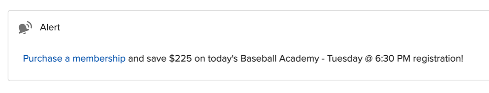
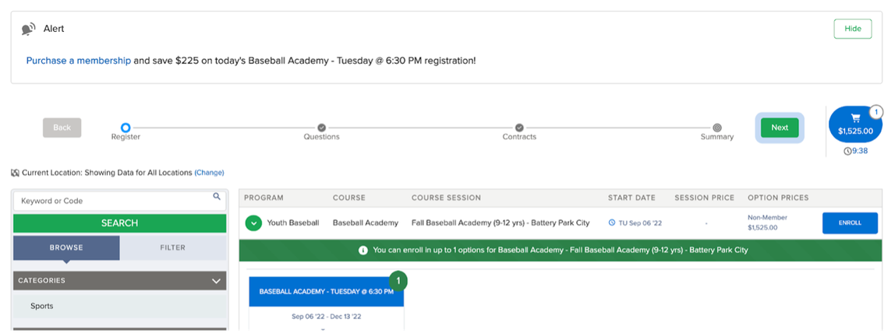

# Dynamic data and rich text

Use formulas in your flow, or build your message string dynamically in Apex, to display dynamic data to the user. The Community Alert's Message is displayed as rich text, so you can include markup to decorate the display or hyperlink text.

For example, this flow formula builds a message with a link to a membership page, the savings calculated earlier in the flow, and the name of the course option being registered for:

```
"<a href=\"https://example.com/membership\">Purchase a membership</a> and save $" +
TEXT({!curPotentialSavings}) +
" on today's " + {!$Record.TREX1__Course_Option__r.Name} + " registration!"
```

The alert as the user sees it in the Community Alerts component:



The same alert at the top of a registration page, with the course in the cart:



A toast on the same page, confirming an enrollment was added to the cart:


## Use cases alongside Traction Rec's Web Reg

- Important Course Option-specific details
    - *Please note that the Mushroom Foragers class meets in Central Park*
    - *The Swim Private Lessons Application is an application and does not constitute enrollment in this course. A staff member will reach out to finalize enrollment.*
    - *It looks like your family has previously only joined us at our Inwood location. Please note that Aramaic 101 takes place at our East Harlem location.*
- Duplicate enrollments
- Enrollments with conflicting dates/times
- Conditional coupon codes (e.g. only display the sibling discount code when two members of the household are being registered into the same course option)
- Membership promotions (display savings amount of member pricing with link to purchase membership)
