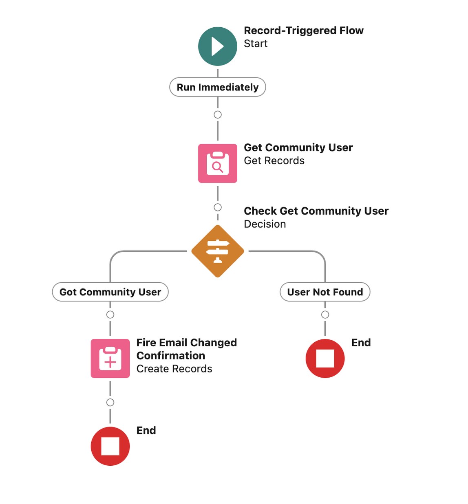
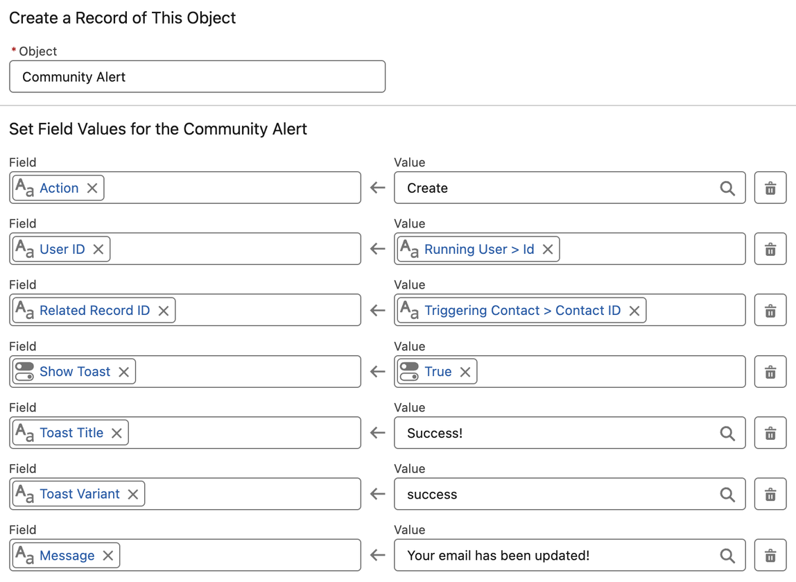
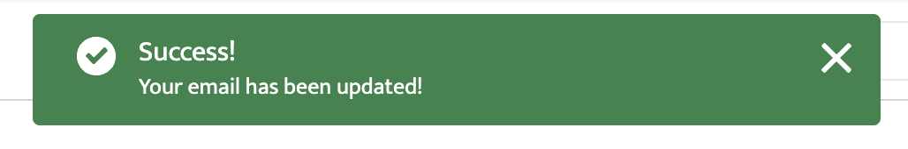

# Publish from Flow

To publish an alert from Flow, add a **Create Records** element for the **Community Alert** object and set its fields.

This sample record-triggered flow displays a confirmation message to the logged-in user when the email address on their contact record has been updated. It looks up the community user for the contact and, if one is found, creates the alert.

Here's a look at the Create Records element above (Fire Email Changed Confirmation). **Action** is `Create`, **User ID** is the running user's ID, **Related Record ID** is the triggering contact's ID, **Show Toast** is on, and the toast has a title, a variant and a message.

The resulting toast message when the logged-in user's email address is changed looks like this:

